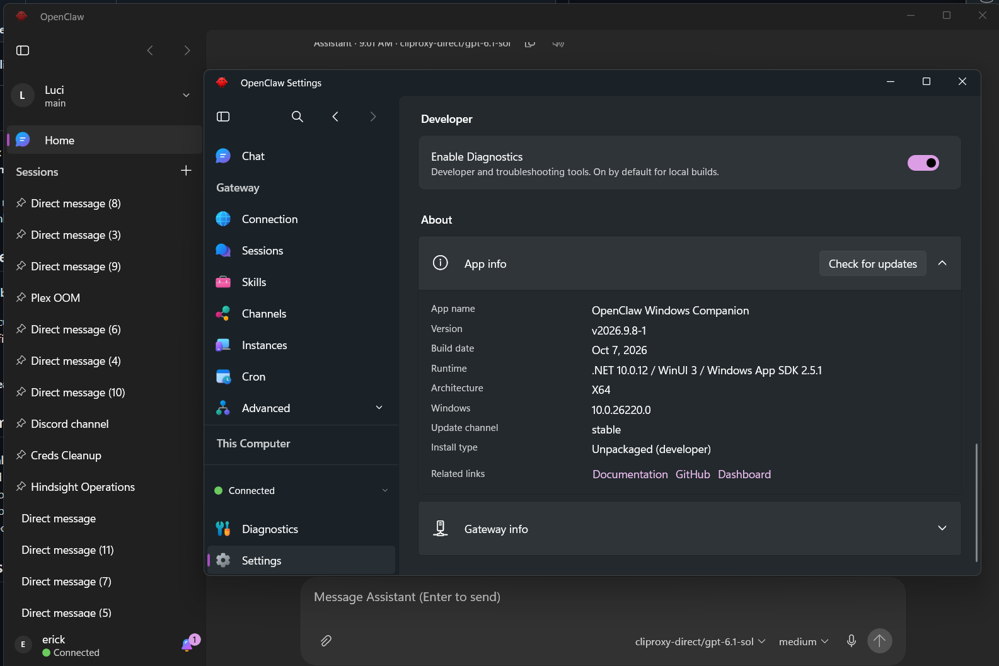
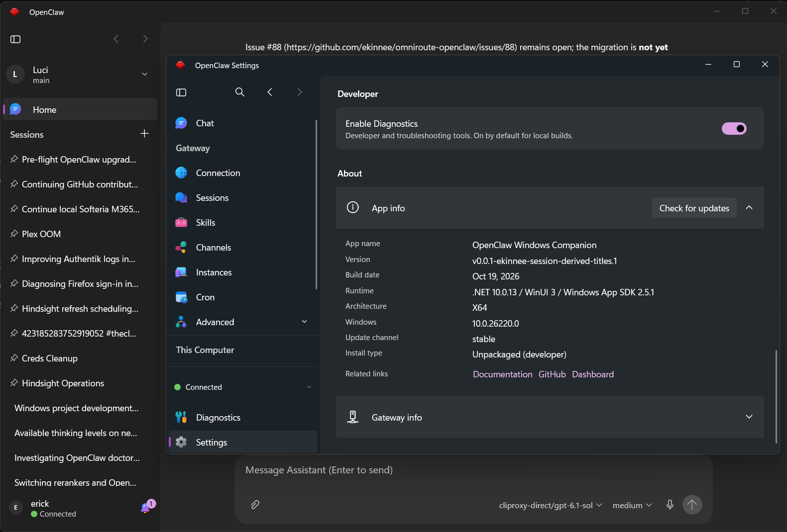
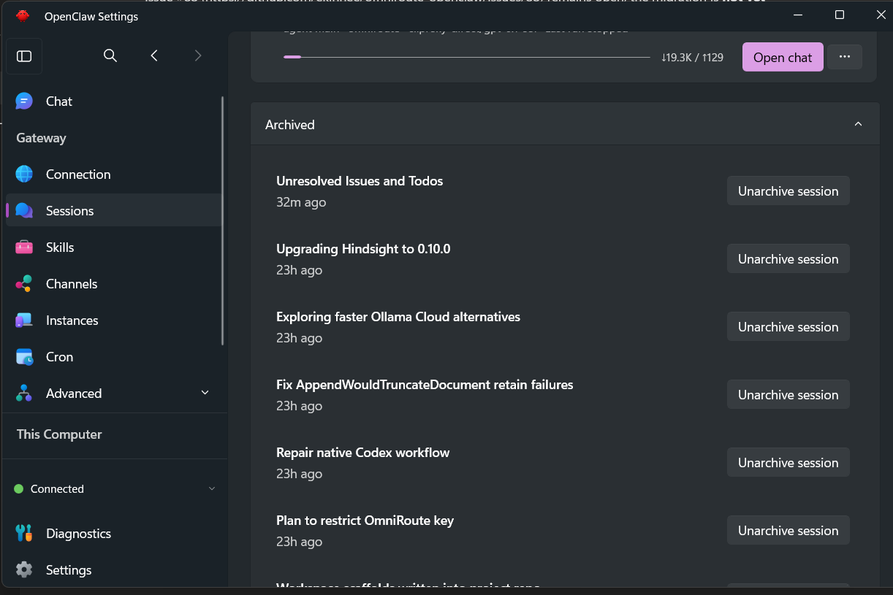

# Latest-stable to PR-head profile carry-forward proof

Observed October 19, 2026 on Windows x64. Candidate: `8cbdf0e93fdf32c837f550e9ba8083bcfe8a1eca` for PR #1768 (fix: show generated names for unlabeled conversations).

| Check | Result | Evidence and boundary |
| --- | --- | --- |
| Exact latest stable started and connected | PASS | Official portable `v2026.9.8-1`, source `2ba89f377ce8ce3f5ddfc452e4d509329f109114`; About, connected indicator and generic sidebar names visible in baseline screenshot. |
| Same-profile stable-to-head switch | PASS | Stopped the verified isolated stable process, then launched the frozen current-head executable with the same data-directory overrides. No reset, credential re-entry or replacement profile between runs. |
| Existing settings preserved | PASS | All 67 stable-run settings retained equal values after head startup; zero new or removed keys. |
| Saved connection and identity preserved | PASS | One existing Gateway record and active selection retained. Complete registry is structurally equal to the captured original except `lastConnected`; credential fields unchanged. All seven captured identity files are byte-identical. Head diagnostics record Connecting then Connected. |
| Existing conversations accessible | PASS, bounded | The saved default thread identifier is equal across runs. Existing explicitly named entries such as Plex OOM, Creds Cleanup and Hindsight Operations remain visible; generic rows now have readable names. The expanded archived list loads existing named conversations after the switch. The full Gateway session inventory was not enumerated or compared. |
| Original user profile preserved | PASS | All nine captured configuration/identity source files still match their pre-run hashes. |
| Installer/updater lifecycle | UNTESTED | This is a portable binary/profile carry-forward check. It does not exercise signed installation, auto-update, repair, reboot, rollback or uninstall. |

## Frozen artifacts

- Baseline release: [v2026.9.8-1](https://github.com/openclaw/openclaw-windows-node/releases/tag/v2026.9.8-1), official `OpenClawTray-2026.9.8-1-win-x64.zip`.
- Downloaded archive SHA256 matched the GitHub release asset digest: `c50955809afdd07c0d2c17f30bf7c45cf06bed09d751a915bd92945be27f2047`.
- Stable executable product version: `2026.9.8-1+2ba89f377ce8ce3f5ddfc452e4d509329f109114`.
- Stable executable SHA256: `1e10fa66f2f38b8521263d9f6080f9c6283f55b35474cba6e2b60ac46370c462`.
- Target executable product version embeds `8cbdf0e93fdf32c837f550e9ba8083bcfe8a1eca`; executable SHA256: `d88bdcb7c7b2df8f470ef009142cba672697f2b2596233b26a67c285f9691cec`.
- All five changed-file SHA256 values match the reviewed candidate manifest; no source change or rebuild occurred during this check.

## Procedure and isolation

1. With the user's explicit permission and all Companion instances closed, copy the existing normal profile's configuration and identities to a private, access-restricted baseline outside the repository. Create a writable working copy. Nine files were captured. Logs, models, migration backups and the unused MCP token were excluded.
2. Before either run, set `EnableNodeMode=false`, `AutoStart=false` and `EnableManagedLocalGatewayAutoRepair=false` in the working copy. These containment overrides were identical for stable and head. The 67-setting preservation comparison is against this prepared stable-run configuration.
3. Launch the official portable stable executable with `OPENCLAW_TRAY_DATA_DIR` and `OPENCLAW_TRAY_LOCAL_DATA_DIR` pointing to that working copy. Use the existing saved credentials and existing Gateway. Confirm Connected and capture About with the active sidebar.
4. Capture the stable-run settings, identity manifest and selected-thread cache privately. Stop only the verified task-owned stable process, then launch the current-head executable with the identical directory overrides. The stable process was stopped by the controller after capturing the baseline; a graceful app-exit lifecycle was not tested.
5. Confirm the candidate executable's identity and successful connection. Compare settings semantically, identities by hash, the Gateway registry structurally excluding its connection timestamp, and the cached default-thread identifier. No credential values or session identifiers are included in this report.
6. The developer captures current-head About with the active sidebar, then Settings > Sessions > Archived. Both current-head views show existing conversations with readable names and Connected status. No messages were sent and no sessions were renamed, archived, restored or deleted to manufacture evidence.
7. Recheck the original profile's nine captured files. All match their initial hashes. The installed normal application and original profile were not replaced.

Sessions remain owned by the existing Gateway. This run proves successful access to the observed existing conversations after client replacement and retained local connection state; it does not establish a complete server-side inventory or database migration result.

## Developer-provided screenshots

These three images were supplied by the developer during the rehearsal and were not edited by the agent. They show the inspected UI and visible names. The JSON receipt contains only redacted counts, boolean results, artifact identities and screenshot hashes. Raw profiles, credentials, identities and private logs remain local and are not part of the public evidence.

**Before: stable About, connected status and generic sidebar labels**

**After: current-head About, connected status and readable sidebar names**

**After: current-head archived conversations load with readable names**

[Redacted machine-readable receipt](upgrade-check-final.json)

## Remaining limits

No controlled live raw-field comparison, explicit-label mutation, or deliberately title-free record was created. Existing resolver and production-client WebSocket regressions cover those request, precedence, privacy and fallback contracts. Earlier initial-inventory refresh behavior and session grouping remain outside this patch. This rehearsal does not claim completion of the full `windows-winui-interactive` or `windows-clean-installer-upgrade` proof pools. Reviewer acceptance of this evidence remains pending.
